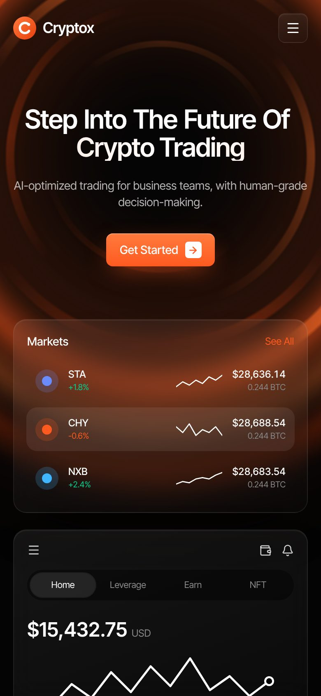
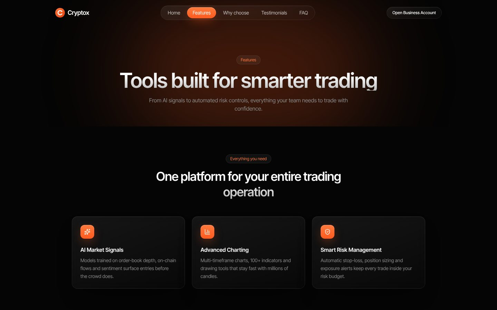
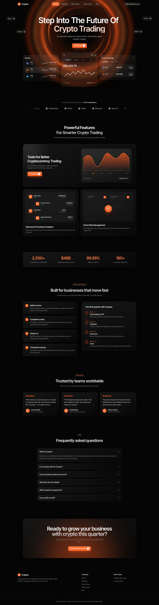

# Cryptox: Crypto Trading Landing Site

**Live demo → [cryptox-omega-nine.vercel.app](https://cryptox-omega-nine.vercel.app)**

A multi-page, fully animated marketing site for a fictional AI-powered crypto trading platform aimed at businesses.
Designed for dark mode, responsive down to 360px, and deployed on Vercel with automatic deploys from GitHub.


## Highlights

- **6 pages**: Home, Features, Why Choose, Testimonials, FAQ, Contact, with smooth page transitions
- **Motion design** built with Framer Motion:
  - word-by-word headline reveal, a rotating vortex with scroll parallax, floating partner tags
  - 3D card entrance, live-ticking market prices, a self-drawing balance chart
  - a morphing area chart (1H → ALL), a coin-swap animation and a pulsing risk shield
  - scroll reveals, count-up stats, a sliding nav pill and an animated FAQ accordion
- **Interactive UI**: chart range tabs, balance tabs, swap button, mobile menu, contact form
- **Accessible**: honours `prefers-reduced-motion`, semantic markup, keyboard-friendly controls
- **Fast**: ~150 KB gzipped JS, static build, no server required

| Mobile | Features page |
| --- | --- |
|  |  |

<details>
<summary>Full home page</summary>



</details>

## Tech stack

React 19 · TypeScript · Vite · Tailwind CSS v4 · Framer Motion · React Router · Lucide icons · Vercel

## Run locally

```bash
npm install
npm run dev      # http://localhost:5173
npm run build    # production build in dist/
```

## Project structure

```
src/
  components/   reusable UI (Navbar, Footer, Reveal, Counter, Sparkline…)
  sections/     page sections (Hero, FeatureShowcase, WhyChoose, Faq…)
  pages/        route pages
  lib/data.ts   all copy and content in one place, easy to rebrand
```

## Deploy

`vercel.json` configures the Vite build and SPA rewrites. Import the repo in Vercel or run `npx vercel --prod`.

---

Cryptox is a fictional brand. All names, figures and testimonials are placeholder content.
